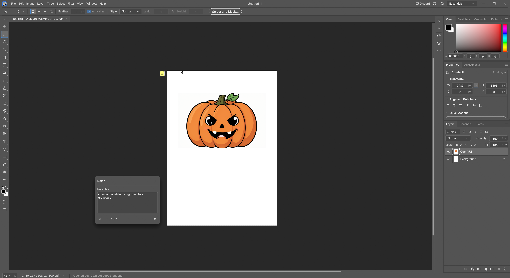
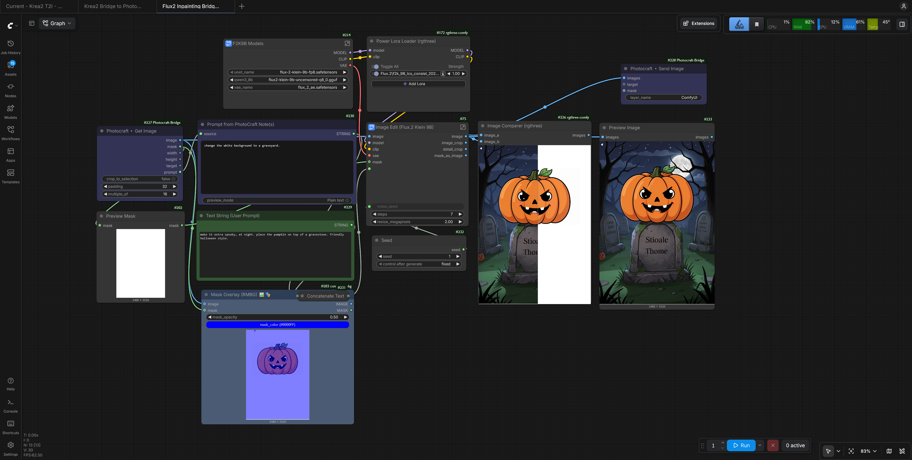
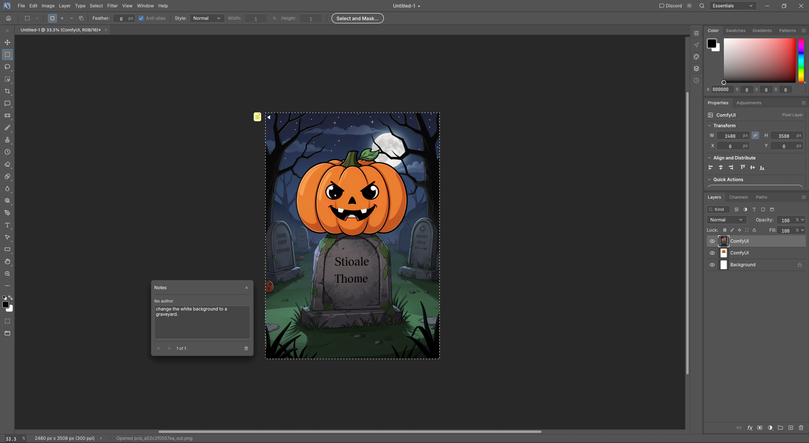

# ComfyUI ⇄ PhotoCraft Bridge

Two ComfyUI nodes that connect a ComfyUI workflow to [PhotoCraft](https://github.com/storytold/photocraft), the open-source Photoshop reimplementation in Rust. They work like a subgraph's input and output:

- **Photocraft ▸ Get Image** reads the active PhotoCraft document (flattened), its selection as a `MASK`, the width and height, a `target` (which document, and where) and a `prompt` taken from the document's notes.
- **Photocraft ◂ Send Image** puts the result back as a new layer in that document, at the right position.

A typical round trip: Draw a selection on an image in PhotoCraft, write a prompt into a note, press Queue in ComfyUI, and the inpainted result appears as a layer over the selection.

## How it works

There is no PhotoCraft plugin. PhotoCraft's plugins are sandboxed WebAssembly filters without network or file access, so they can't talk to ComfyUI. Instead the nodes use PhotoCraft's built-in control channel (see `docs/control-protocol.md` in the PhotoCraft repo): commands go as JSON lines over `127.0.0.1`, pixels go as PNG files through a shared folder.

Get never modifies your document: it exports a flattened duplicate and a copy of the selection, then closes both. Send adds one undo step per image (the new layer).

## Installation

1. Install the nodes, either through **ComfyUI-Manager** (search for "PhotoCraft Bridge") or by opening a CLI in `ComfyUI/custom_nodes/` and running `git clone https://github.com/the-aSak/ComfyUI-Photocraft-Bridge.git`.
2. Restart ComfyUI. On its first start the bridge creates the exchange folder `~/photocraft-bridge` (Windows: `C:\Users\<Profile>\photocraft-bridge`) and prints the exact command for starting PhotoCraft on your machine in the ComfyUI console. The nodes are in the `Photocraft` category.
3. Start PhotoCraft with that command: the control channel enabled and both automation roots set to the exchange folder. PhotoCraft creates the token file on first start. If PhotoCraft isn't running this way, the nodes' error message shows the command again.

   **Windows, Command Prompt** (`cmd.exe`):

   ```bat
   "C:\Program Files\PhotoCraft\photocraft.exe" --control 7878 --control-token-file "%USERPROFILE%\photocraft-bridge\control.token" --automation-read-root "%USERPROFILE%\photocraft-bridge" --automation-write-root "%USERPROFILE%\photocraft-bridge"
   ```

   **Windows, PowerShell**: the same with `& ` in front (PowerShell only runs a quoted path with it) and `$env:USERPROFILE` instead of `%USERPROFILE%`.

   **Linux / macOS**:

   ```sh
   photocraft --control 7878 \
     --control-token-file ~/photocraft-bridge/control.token \
     --automation-read-root ~/photocraft-bridge \
     --automation-write-root ~/photocraft-bridge
   ```

   **Running PhotoCraft from source?** Put the arguments after `--`, otherwise Cargo tries to read them itself:

   `cargo run --release -p photocraft -- --control 7878 --control-token-file ~/photocraft-bridge/control.token --automation-read-root ~/photocraft-bridge --automation-write-root ~/photocraft-bridge`

4. Optional: to use a different port or folder, create a `config.json` in the node folder with just the values you change, e.g.:

   ```json
   { "port": 7878, "token_file": "~/my-folder/control.token", "bridge_dir": "~/my-folder" }
   ```

   `bridge_dir` must be the same folder as the automation roots. `~` stands for your home folder, on Windows too. The file is git-ignored, so updates never overwrite it. Restart ComfyUI afterwards.

## Usage

**Whole image**: Connect Get's `image` to your workflow and its result to Send. Connect Get's `target` to Send. Press Queue; the result appears as a layer named `ComfyUI` above the active layer.

**Inpainting part of the image:** Create a selection in PhotoCraft. In Get, turn on `crop_to_selection` and set `padding` for the context around the selection. Get outputs only that area plus the mask, and `target` remembers where it came from. Send puts the result back there and replaces only the selection, like Photoshop's Generative Fill: Get's mask travels along with `target` and becomes the new layer's alpha. A mask connected to Send's `mask` input overrides it, e.g. a Solid Mask of 1.0 to replace the whole area including the padding.

**Painting the mask:** use Quick Mask mode (`Q`), as in Photoshop. While it is on, Get takes the painted mask. Like Photoshop, PhotoCraft paints in red what is *not* selected ("Color Indicates: Masked Areas"). If you painted the area to change in red, turn on Get's `invert_mask`, or switch the Quick Mask to "Color Indicates Selected Areas" (right-click it in the Channels panel). `invert_mask` also works for ordinary selections ("change everything but this"). A layer mask is not a selection, and it hides the pixels it covers: Ctrl-click (⌘-click) its thumbnail to load it as a selection, then disable or delete the mask.

**Keep the mask editable:** turn on Send's `layer_mask`. The mask then becomes a layer mask instead of the layer's transparency, and the complete generated image lies underneath: paint the mask white to reveal more of it, black to hide.

**Only the active layer:** set Get's `source` to `active layer` to send just that layer instead of the visible composite. Its transparent areas become white.

**Prompt from PhotoCraft:** Prompts can be edited within the workflow or in the style of proprietary software in form of Notes. Select the Note tool (in the Eyedropper tool group, right-click the eyedropper icon), click anywhere on the canvas and type the prompt into the Notes panel. Notes are never rendered into the image. Get outputs their text as `prompt`; connect it to your text encoder's `text` input. Several notes are joined line by line, empty ones skipped.

**Generate while you type:** set Get's `trigger` to `note change` and switch ComfyUI's Run button to **Run (Instant)** (the arrow next to Run), then click Run once to start it: the button now reads "Stop Run (Instant)", and the console says the bridge is waiting for the notes. ("Run (On Change)" won't do: it only reacts to changes in the workflow, not in PhotoCraft.) Each run then waits until the notes in PhotoCraft have changed and rested for two seconds, and generates with the new text. Typing again while a generation runs cancels it, so the newest prompt wins and only one generation ever runs at a time. A run with unchanged notes just waits, and an empty note never starts one. To stop, click the Run button again ("Stop Run (Instant)"), then cancel the waiting run.

`width` and `height` are the size of what Get outputs, e.g. for `Empty Latent Image`.

Get re-reads the document on every Queue (no caching), so changes in PhotoCraft are always picked up.

**Run workflow in ComfyUI**.

## Illustrative examples







### Pixel-exact placement (`multiple_of`, default 16)

`VAE Encode` centre-crops images whose sides aren't multiples of 8, and Flux-type models (Flux, Krea) want multiples of 16. The result would then sit a few pixels off. So Get grows the cropped area to multiples of `multiple_of`, and where that isn't possible (canvas edge, an odd document size) pads right/bottom with edge pixels. Send cuts the padding off again. For SD 1.5 / SDXL, 8 is enough.

If the workflow resizes on its own (e.g. to a fixed megapixel count), Send scales the result back and says so in the ComfyUI console (`[Photocraft] result … scaled to …`). If that resize changes the aspect ratio or crops edges, the result won't line up exactly; make the resize node round to multiples of 16, or drop it.

### Without `target`

If Send's `target` isn't connected, it uses the target of the last Get run, as long as that document is still open. Otherwise the result goes into the active document at (0, 0), or into a new document if none is open. Connecting `target` is still the safer choice: it ties Send to the Get of the same workflow.

Send finds the document by its layers, not its name, so saving it under a new name while the workflow runs is fine.

## Limits

- Runs start from ComfyUI: by Queue, or on their own when the notes change (`trigger`). A button inside PhotoCraft isn't possible, because PhotoCraft's plugins have no network access.
- Images travel as 8-bit PNG. 16-bit documents come back as 8-bit layers.
- Get exports either the visible composite or the active layer (`source`), not an arbitrary set of layers. Transparent areas reach the workflow as white.
- PhotoCraft calls itself early alpha; command names may change. Tested against `storytold/photocraft` as of 10 October 2026.
- Colour profiles: models work in sRGB, so Get converts documents in other profiles (Adobe RGB, Display P3, ...) to sRGB, and PhotoCraft converts the result back into the document's profile. Unchanged pixels survive the round trip; colours outside sRGB can't, so in edited areas they come back clipped to sRGB.

## Security

- **The token is not in this repository.** `config.json` only holds the *path* to the token file. PhotoCraft creates that file in your exchange folder, and `.gitignore` excludes `*.token` in case it ever lands here.
- **Local only.** PhotoCraft binds its control channel to `127.0.0.1` and cannot be reached from other machines. The nodes always connect to `127.0.0.1` as well; there is deliberately no host setting, because the token travels unencrypted.
- **Anyone who has the token can fully control PhotoCraft** (run any command, read and write files in the exchange folder). Keep the token file private, and don't forward the port or tunnel it to another machine. If you think it leaked, delete the token file and restart PhotoCraft: it creates a new one.

## Credits and license

Written by Claude (Anthropic), commissioned and tested by [the-aSak](https://github.com/the-aSak/).

Released into the public domain under [The Unlicense](LICENSE).
